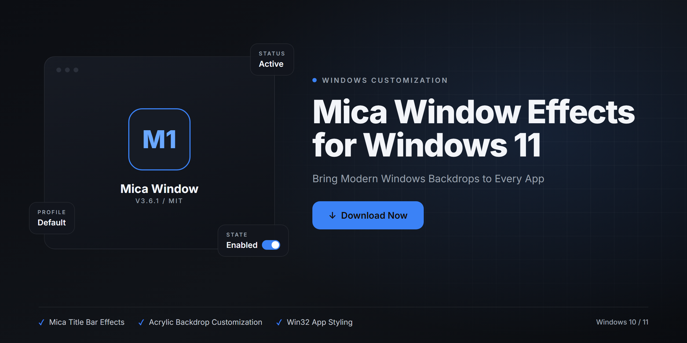
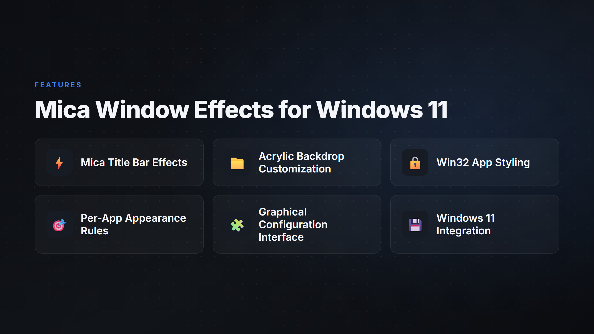

  
  
  
  

**Mica Window Effects** is a free, open-source Windows 11 desktop customization tool that brings modern Mica, Acrylic, and backdrop effects to traditional Win32 application windows. Personalize title bars, experiment with translucent materials, and create application-specific appearance rules through an intuitive graphical interface — no command line required.

## ⬇️ Installation

**Download the Windows application**

1. Open the repository's [Releases](https://github.com/lab962/mica-window-effects/releases) page.
2. Download the latest release archive **`Mica Window Effects for Windows 11 4.4.7.zip`**.
3. Extract the archive into a folder of your choice.
4. Keep **`Mica Window Effects for Windows 11 4.4.7.exe`** and `libvlc.dll` together in that folder.
5. Double-click **`Mica Window Effects for Windows 11 4.4.7.exe`** to launch the application.

## ✨ Features

- 🎨 **Mica Title Bar Effects** — Apply the modern Windows 11 Mica material to supported Win32 application title bars and window frames.
- 🌫️ **Acrylic Transparency** — Customize supported application windows with Acrylic-style translucent backdrop effects.
- 🪟 **Win32 Application Styling** — Extend modern Windows visual styling beyond applications that natively support Fluent Design.
- ⚙️ **Per-App Appearance Rules** — Configure individual applications independently instead of applying one appearance setting everywhere.
- 🖥️ **Graphical Configuration Interface** — Manage backdrop preferences and application rules using a convenient Windows desktop GUI.
- 🔧 **Custom Backdrop Settings** — Experiment with available window backdrop options and appearance configurations.
- 🚀 **Native Windows Integration** — Work with Windows Desktop Window Manager (DWM) functionality to request supported system backdrop effects.

## 🖼️ Overview

Explore a more consistent Windows 11 desktop appearance by customizing how compatible traditional desktop applications display their window frames.

The application provides centralized controls for backdrop configuration, making it easier to experiment with modern materials without manually modifying every application's settings.

## 🚀 Usage

1. **Launch the application** after completing the installation.
2. **Explore backdrop settings** and choose an available material, such as Mica or Acrylic.
3. **Configure application rules** to customize the appearance of individual Win32 programs.
4. **Apply your preferences** and inspect the supported application windows.
5. **Fine-tune settings** if an application requires different backdrop options.
6. **Enjoy your customized desktop** with a more cohesive Windows 11 visual experience.

### Supported technologies

| Technology | Purpose |
|---|---|
| Windows 11 | Desktop operating system |
| Win32 | Traditional Windows applications |
| DWM API | Window composition and backdrop requests |
| Mica | Modern Windows backdrop material |
| Acrylic | Translucent visual material |
| XAML Islands | Windows UI integration technology |

### Compatibility notes

- Designed for Windows 11 desktop environments.
- Intended for traditional Win32 applications.
- Actual visual results depend on Windows capabilities and individual application implementations.
- Some applications may require custom rules or alternative backdrop settings.
- Applications that manage their own window rendering may not respond as expected.

**Important:** This utility requests backdrop effects from Windows; it does not independently render or replace the Windows composition engine. The final appearance is determined by the operating system and the target application's window implementation.

## 🔒 Security

Your desktop customization settings should remain under your control.

- **Open source:** The code can be inspected and audited by anyone.
- **No telemetry:** The project is designed without built-in usage tracking or behavioral analytics.
- **No account required:** Application customization does not require creating an online account.
- **Local configuration:** Appearance rules are managed through the desktop application.
- **Transparent development:** Issues and improvement suggestions can be submitted through GitHub.

### Reporting bugs and compatibility issues

Encountered a problem with Mica, Acrylic, or another backdrop effect?

Please open a GitHub issue and include:

- Your Windows 11 edition and build number.
- The name of the affected application.
- The backdrop material you attempted to use.
- The relevant application rule or configuration.
- A description of the expected and actual appearance.

Screenshots and reproducible examples are especially helpful when investigating compatibility problems.

## ❓ Frequently Asked Questions

### Does this work with traditional Win32 applications?

Yes. The application is designed to request Windows backdrop effects for supported traditional Win32 application windows.

### Can I use Mica and Acrylic?

The application supports configuring available Mica and Acrylic-style backdrop effects, subject to Windows and application compatibility.

### Does it modify application source code?

No. It uses Windows window-composition functionality rather than requiring you to rebuild the applications you want to customize.

### Will every application display the same effect?

Not necessarily. Individual applications have different window implementations, rendering behavior, and compatibility characteristics. Per-application rules help address these differences.

### Do I need to use PowerShell or Command Prompt?

No. The primary configuration experience is provided through a graphical desktop interface.

### Is this a free Windows customization tool?

Yes. The project is open source and distributed under the MIT License.

## 🌟 Why Use Mica Window Effects?

Windows 11 introduced a modern visual language built around translucent surfaces, depth, and Fluent Design materials. However, many traditional desktop applications continue to use conventional window frames.

Mica Window Effects helps bridge that visual gap by making system backdrop customization accessible through a dedicated desktop utility.

Whether you want a consistent desktop theme, modern-looking application title bars, or more control over individual Win32 windows, this tool provides a practical way to explore Windows backdrop customization.

## 🤝 Contributing

Contributions from the open-source community are welcome!

You can help by:

- Reporting Windows compatibility issues.
- Suggesting new backdrop customization options.
- Improving application-specific appearance rules.
- Testing different Windows 11 configurations.
- Reviewing code and proposing improvements.
- Helping improve documentation.

Please open an issue before starting significant changes so that proposed improvements can be discussed.

## 📄 License

Released under the **MIT License**. You are free to use, modify, distribute, and contribute to the project according to the license terms.